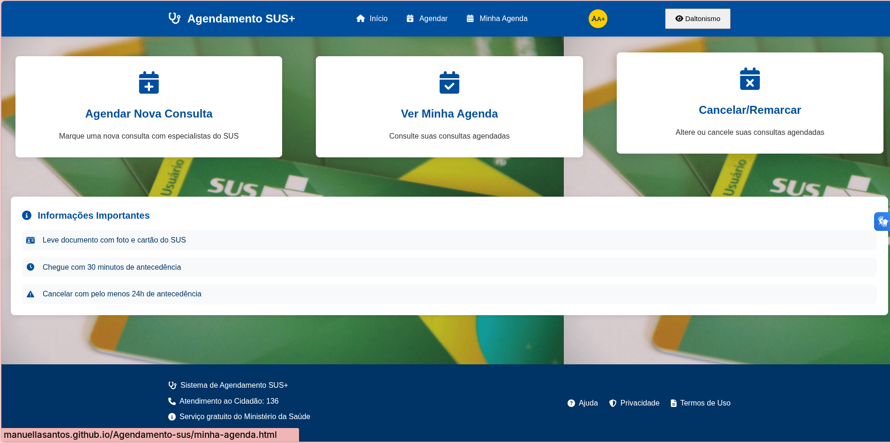

# Agendamento SUS - Plataforma de Agendamento de Consultas e Serviços

Projeto da **Atividade Final de UDIAD**, cujo objetivo era criar um protótipo funcional de um serviço ou solução digital inclusiva.

A solução escolhida foi uma plataforma de agendamento de consultas ou serviços, onde o usuário escolhe o atendimento que precisa, marca o horário e acompanha seus agendamentos.

# Acesse aqui:
https://manuellasantos.github.io/Agendamento-sus/

## Prévia

## Tecnologias utilizadas

## Contribuidores

| Nome | GitHub |
|---|---|
| Manuella Santos Cruz | [Manuellasantos](https://github.com/Manuellasantos) |
| Matheus Bonfim Batista | [MatheusBonfim265](https://github.com/MatheusBonfim265) |
| Fernanda Marques | [nanda-marques](https://github.com/nanda-marques) |
